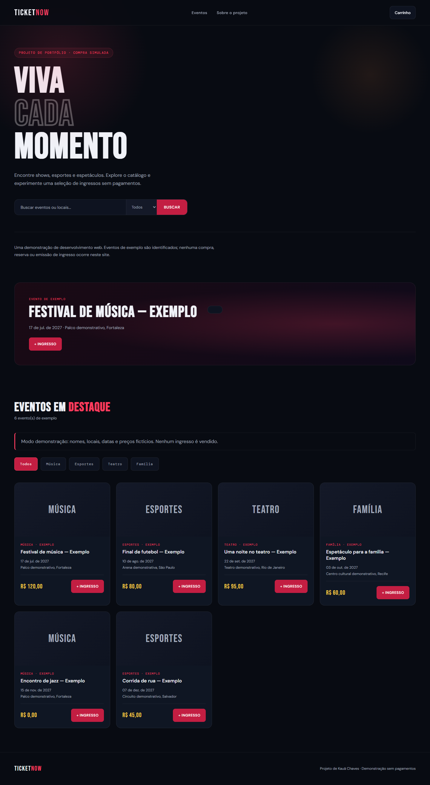

# TicketNow

Catálogo de eventos e carrinho demonstrativo de ingressos, desenvolvido por Kauã Chaves com HTML, CSS, JavaScript e Node.js. O projeto preserva a identidade visual original e separa interface, regras de domínio e integração com a API.

> **Projeto de portfólio. Não vende, reserva, cobra ou emite ingressos. Não solicita cartão, CPF, telefone ou e-mail.**

[Abrir aplicação com back-end](https://ticketnow-lilac.vercel.app/) · [Versão estática no GitHub Pages](https://kaua-chavesvk.github.io/ticketnow-portifolio/) · [Roteiro de apresentação](docs/apresentacao.md) · [Testes](https://github.com/kaua-chavesvk/ticketnow-portifolio/actions)

**Publicação:** a aplicação e a API estão hospedadas na Vercel. Sem `TICKETMASTER_API_KEY`, o servidor responde com o catálogo demonstrativo. Veja [como cadastrar a nova chave e republicar](docs/publicacao.md). O catálogo real ainda depende dessa configuração; não há uma chave válida embutida no projeto.

## Prévia



<details>
<summary>Ver versão para celular</summary>


</details>

As capturas mostram o modo demonstrativo. No GitHub Pages, os eventos são fictícios e identificados como exemplos; a integração com a Ticketmaster exige executar o servidor com uma chave privada.

## O que este projeto demonstra

- Interface responsiva em português, com busca por evento/local e filtros de categoria.
- Manipulação segura de conteúdo externo por DOM e `textContent`.
- Carrinho simulado com limite de quantidade e cálculo em centavos.
- Diálogos acessíveis por teclado, tratamento de resultados vazios e falhas de carregamento.
- Integração opcional com API externa por um servidor Node.js, com validação, limites, cache e testes.

## Estrutura

```text
index.html             Estrutura semântica e política CSP
public/styles.css      Identidade visual e responsividade
public/app.js          Busca, renderização e interações
public/model.js        Regras de eventos, URLs, filtros e carrinho
server.js              Arquivos públicos e API opcional
api/events.js          Entrada da API na Vercel
scripts/build.mjs       Gera somente os arquivos públicos em dist/
vercel.json            Configuração de publicação e cabeçalhos
test/                  Testes de regras e servidor
docs/                  Roteiro e capturas de demonstração
.github/workflows/     Verificações automáticas
```

## Executar

Requer Node.js 22 ou superior. Não há dependências externas de execução nem etapa de build.

```sh
npm start
```

Abra http://localhost:3000. Sem chave configurada, a aplicação usa eventos fictícios explicitamente identificados. Busca por nome/local, filtros combinados e carrinho funcionam no modo demonstração. O carrinho fica somente em memória e é apagado ao recarregar a página ou concluir a simulação.

```sh
npm run check
npm test
```

Os testes usam `node:test` e cobrem moeda/preços desconhecidos, filtros, limites do carrinho, URLs maliciosas, validação da API, rate limit, arquivos privados, cache, concorrência e erros do fornecedor. Não chamam a API real nem precisam de credenciais.

## Catálogo real (opcional)

1. Crie sua própria chave na [Ticketmaster Developer](https://developer.ticketmaster.com/).
2. Copie `.env.example` para `.env` e preencha `TICKETMASTER_API_KEY` **somente nesse arquivo ou nas variáveis privadas da hospedagem**.
3. Execute `npm start`. A interface acessa `GET /api/events`; só o servidor chama a Ticketmaster.

**A chave anteriormente presente no repositório deve ser revogada/substituída no painel do fornecedor.** Removê-la do código não elimina as cópias no histórico ou em clones. Esta alteração não reescreve o histórico e não revoga a chave automaticamente.

A API aceita `keyword` (até 100 caracteres), `category` (categorias conhecidas) e `page` (0–49). Retorna apenas campos normalizados. Valores em BRL são exibidos como preços iniciais; ausência de preço ou outra moeda aparece como “Preço a consultar”. Eventos reais levam ao fornecedor em nova aba, sem simular venda local. Uma resposta real vazia continua vazia. Falhas no catálogo exibem um aviso antes dos exemplos.

## Hospedagem

- **GitHub Pages:** publique a raiz do repositório. Os caminhos são relativos e suportam `/ticketnow-portifolio/`. Como Pages hospeda conteúdo estático e não executa Node.js, o site usa o catálogo demonstrativo quando `/api/events` não existe. Não coloque a chave em um arquivo público para tentar ativar a API.
- **Vercel:** [ticketnow-lilac.vercel.app](https://ticketnow-lilac.vercel.app/). A função `/api/events` usa o mesmo handler testado pelo servidor local. `npm run build` gera `dist/` com apenas o HTML e três assets; a função fica no ambiente Node.js, fora da saída pública. Consulte [configuração, atualização e limites](docs/publicacao.md).
- **Servidor Node.js tradicional:** hospede a raiz com `npm start`, configure `PORT`, `HOST=0.0.0.0` e a chave no painel privado da plataforma. Use HTTPS no proxy da hospedagem. O servidor só entrega o HTML e os três assets explicitamente permitidos; `.env`, `.git`, testes e código do servidor não são servidos.
- A política CSP no HTML funciona na hospedagem estática. As proteções de cabeçalhos (incluindo bloqueio de iframe) são enviadas pelo servidor Node; o GitHub Pages não aplica os cabeçalhos personalizados deste servidor.

## Proteções e limites

- Renderização por `textContent`/DOM; sem `innerHTML`, handlers inline ou JavaScript embutido.
- CSP restritiva; imagens e links externos com HTTPS e lista explícita de domínios. Links externos usam `noopener noreferrer`.
- Endpoint externo fixo, sem redirecionamentos, timeout de 7 segundos e resposta limitada a 2 MB.
- Até 30 buscas por minuto por endereço de conexão e 200 no total por processo; `429` inclui `Retry-After`. Máximo de quatro consultas simultâneas distintas; requisições iguais compartilham a consulta.
- Cache em memória por 60 segundos e até 100 buscas. A chave e erros brutos do fornecedor não são devolvidos ao navegador ou registrados pelo aplicativo.
- O servidor ignora `X-Forwarded-For` para impedir falsificação. Atrás de um proxy, visitantes podem compartilhar o mesmo limite por conexão. Para múltiplas instâncias ou tráfego público relevante, implemente limites/cota compartilhados no gateway e armazenamento externo; estes controles locais não são proteção completa contra DDoS nem garantem a cota diária do fornecedor.
- Não existem contas, banco de dados, estoque, pedidos persistidos ou pagamentos. Uma versão comercial exige essas implementações, cálculo de valores no servidor, checkout hospedado em provedor de pagamentos e verificação de webhooks/idempotência antes de anunciar compras reais.

## Interface

Navegação semântica, busca por Enter, campos com rótulos, filtros com `aria-pressed`, avisos de status, diálogos nativos com Escape e foco contido, retorno de foco, redução de movimento, áreas de toque de 44 px e layout adaptável a telas de 320 px. Dados fictícios e estatísticas inventadas não são apresentados como informações reais.

## Referências

- [Ticketmaster Discovery API](https://developer.ticketmaster.com/products-and-docs/apis/discovery-api/v2/)
- [HTTP no Node.js](https://nodejs.org/api/http.html)
- [Sobre o GitHub Pages](https://docs.github.com/en/pages/getting-started-with-github-pages/what-is-github-pages)
